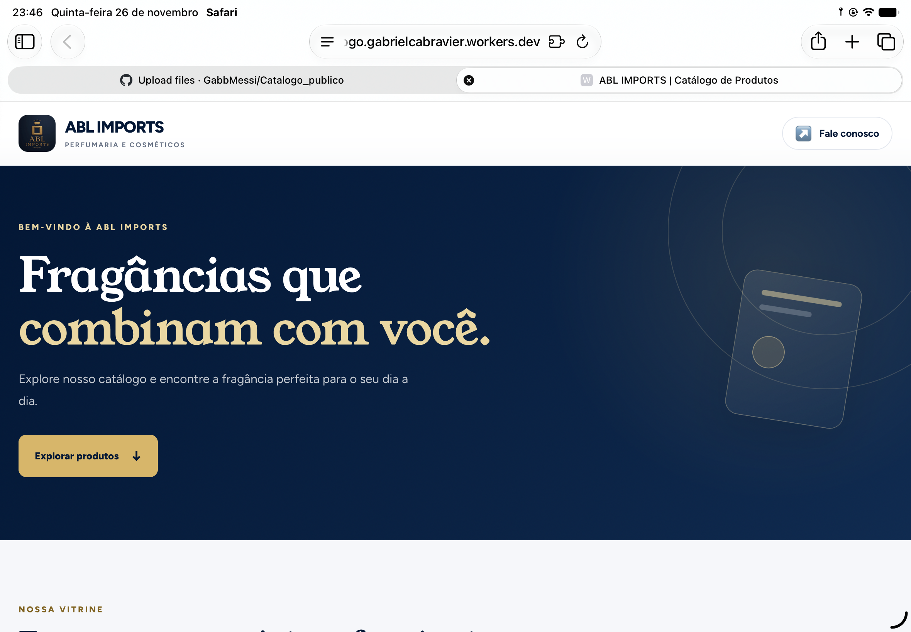
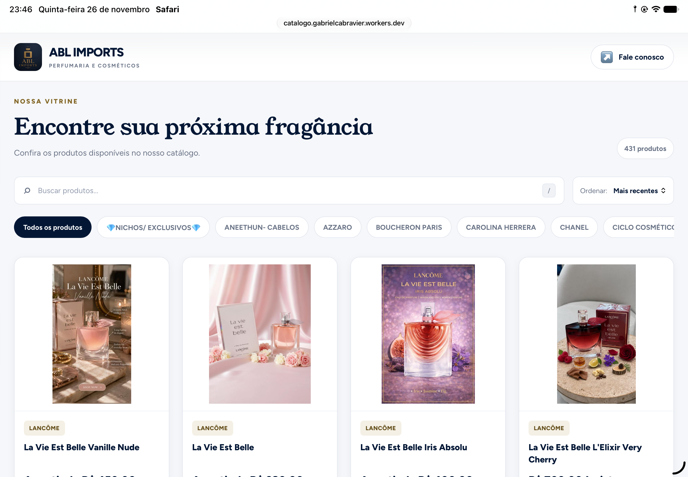
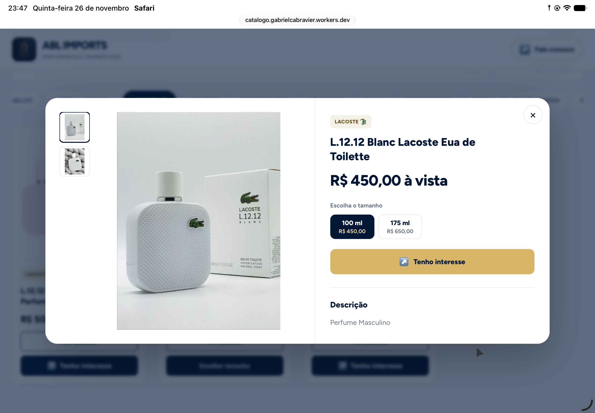

# ABL IMPORTS — Catálogo Público

Aplicação web desenvolvida para apresentar os produtos da ABL IMPORTS, permitindo que clientes consultem o catálogo, explorem categorias, visualizem detalhes dos produtos e iniciem pedidos diretamente pelo WhatsApp.

## Sobre o projeto

O catálogo foi desenvolvido para oferecer uma experiência de navegação simples, organizada e responsiva, facilitando a consulta aos produtos e suas respectivas informações.

A aplicação utiliza integração com Supabase para consultar os dados cadastrados e manter as informações do catálogo atualizadas automaticamente.

## Funcionalidades

- Visualização dinâmica dos produtos cadastrados.
- Pesquisa por nome, categoria ou descrição.
- Filtragem por categorias.
- Ordenação por data de cadastro e preço.
- Exibição de preços e variações de volume (ml).
- Visualização detalhada dos produtos.
- Galeria de imagens com ampliação.
- Integração com WhatsApp para atendimento e pedidos.
- Atualização automática das informações por Supabase Realtime.
- Interface responsiva para dispositivos móveis e computadores.

## Tecnologias utilizadas

- **HTML5:** estrutura da aplicação.
- **CSS3:** estilização e responsividade.
- **JavaScript:** funcionalidades e manipulação dinâmica da interface.
- **Supabase:** banco de dados e integração de informações.
- **Supabase Realtime:** sincronização automática das alterações no catálogo.

## Estrutura do projeto

| Arquivo | Descrição |
|---|---|
| `index.html` | Estrutura principal da aplicação. |
| `loja.css` | Estilos e layout da interface. |
| `loja.js` | Lógica e funcionalidades do catálogo. |
| `supabase-config.js` | Configurações de conexão com o Supabase. |

## Prévia do projeto

### Catálogo público

### Produtos

### Detalhes do produto

## Acesso à aplicação

O catálogo possui uma versão publicada na web, permitindo que os clientes consultem os produtos disponíveis e entrem em contato diretamente com a empresa.
[**Acessar catálogo público**](https://catalogo.gabrielcabravier.workers.dev)

**ABL IMPORTS — Catálogo de Produtos**

## Segurança

A aplicação utiliza uma chave publicável para comunicação com o Supabase. O acesso aos dados deve ser controlado por políticas de segurança no banco de dados, incluindo Row Level Security (RLS).
